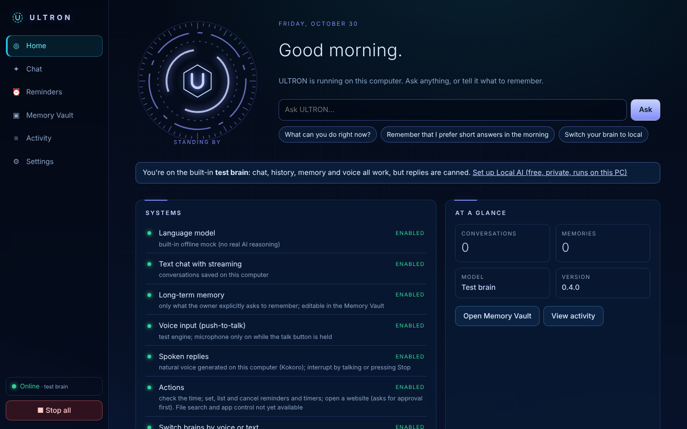

# ULTRON

A private, persistent personal AI assistant that runs on your own Windows PC. ULTRON keeps your conversations,
remembers what you explicitly ask it to, and tells you honestly what it can and can't do.

> ULTRON is software, not a sentient being. It has a personality, not feelings.

**Local-first:** ULTRON's brain, ears and memory can all run on your own computer with no cloud account and no internet
(after one-time downloads). Cloud brains (Claude, OpenAI) are optional extras you can switch to by voice, never a requirement.



## What works today (v0.1, dev cycle 1)

| Feature | Status |
|---|---|
| Chat with streaming replies | ✅ working |
| Conversations saved and restored after restart | ✅ working |
| "Remember that…" / "Forget…" in chat, with a Memory Vault to view, edit, pin, export, delete | ✅ working |
| Memories recalled in *new* conversations, cited as `[memory:xxxxxxxx]` | ✅ working |
| Refuses to store passwords, card numbers, API keys, ID numbers | ✅ working |
| **Local brain** on your PC via Ollama: detects your graphics card, recommends a model, one-click download, works offline | ✅ working (real model tested in CI) |
| Switch brains by voice or chat ("switch your brain to local", "switch to Fable"), with a color skin per brain | ✅ working |
| Optional cloud brains: Claude, OpenAI | ✅ built, **not yet tested with a live key** |
| Original cyan HUD interface, high-contrast and reduced-motion modes, phone-width layout | ✅ working |
| Online/offline indicator, emergency **Stop all**, activity/audit log, redacted log export | ✅ working |
| Voice input: push-to-talk (hold button or Space), speech recognized **on your PC** by Whisper, or OpenAI | ✅ working (see [Voice](docs/VOICE.md)) |
| **Spoken replies** with a natural voice generated **on your PC** (Kokoro), sentence-by-sentence; interrupt by talking, Esc or Stop | ✅ working (real voice tested in CI) |
| **Reminders & timers** ("remind me at 5pm to…", "set a timer for 10 minutes"): pop-up, Windows notification, spoken; missed-while-off shown | ✅ working |
| **Actions with a safety policy**: read-only runs, low-risk is logged, anything external waits for your **Approve** click; kill switch | ✅ working |
| Local file search, wake word, connected accounts, phone access | ⏳ planned (see [ROADMAP](docs/ROADMAP.md)) |

## Start it on Windows (no coding needed)

1. Install **Node.js LTS** (version 22 or newer) from <https://nodejs.org>. Accept the defaults.
2. Get the ULTRON folder onto your PC (download the ZIP from GitHub and unzip it, or `git clone`).
3. Double-click **`Start-ULTRON.bat`**.
   The first run installs components and builds the interface, which takes 1–2 minutes. ULTRON then opens in its own window.
   Keep the small black launcher window open; closing it stops ULTRON.
4. ULTRON starts on a built-in **test brain** (canned replies) so you can try everything immediately.
5. Give it a real, **free, private brain**: install **Ollama** from <https://ollama.com/download> (one installer).
   Then in ULTRON go to **Settings → Language model → Local AI on this PC**, click **Download** on the recommended model, then **Use this brain**.
   Or just say/type **"switch your brain to local"** once a model is downloaded.

> Cloud brains are optional. A Claude.ai or ChatGPT subscription does **not** include API access; API usage is billed separately.

Something wrong? In the ULTRON folder, open PowerShell and run `npm run doctor`. It checks everything and explains fixes in plain English.

## Commands (for developers)

```bash
npm install          # once
npm start            # build UI + run ULTRON at http://localhost:7477
npm run dev          # hot-reload UI at http://localhost:5173 + auto-restarting gateway
npm test             # unit + API integration tests (no API key needed)
npm run test:e2e     # real-browser end-to-end test (needs Playwright + Chromium) + screenshots
npm run lint         # TypeScript type check
npm run doctor       # environment diagnosis
npm run backup       # consistent database snapshot into <data folder>/backups
```

Your data lives in `%APPDATA%\ULTRON` on Windows (`~/.ultron` elsewhere): `ultron.db` (conversations, memories, activity),
`secrets.json` (API keys), `local-token` (session key for the UI).

## Documentation

[User guide](docs/USER_GUIDE.md) · [Architecture](docs/ARCHITECTURE.md) · [Decisions](docs/DECISIONS.md) · [Roadmap](docs/ROADMAP.md) ·
[Voice](docs/VOICE.md) · [Security](SECURITY.md) · [Testing](docs/TESTING.md) · [Changelog](CHANGELOG.md) · [OpenClaw evaluation](docs/OPENCLAW_SPIKE.md)
